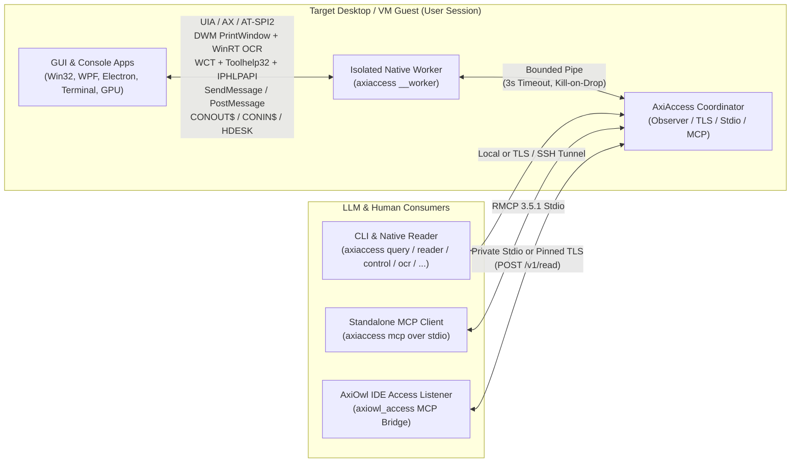

# AxiAccess — Complete Features & API Reference

> **Version:** 2.1.0  
> **Repository:** `https://github.com/morganross/AxiAccess`  
> **Audience:** Human software engineers, system integrators, and LLM coding agents.

---

## Table of Contents

1. [System Architecture Overview](#1-system-architecture-overview)
2. [Core Capability 1: Semantic Accessibility Observation & 5-Tier Verbosity](#2-core-capability-1-semantic-accessibility-observation--5-tier-verbosity)
3. [Core Capability 2: Retained Text Pagination & Event-Driven Structural Diffs](#3-core-capability-2-retained-text-pagination--event-driven-structural-diffs)
4. [Core Capability 3: Focus-Free Background Control (`control_window`)](#4-core-capability-3-focus-free-background-control-control_window)
5. [Core Capability 4: Occluded DWM Capture + Hardware OCR (`ocr_window`)](#5-core-capability-4-occluded-dwm-capture--hardware-ocr-ocr_window)
6. [Core Capability 5: Kernel Wait Chain Traversal (WCT) & Process Telemetry (`inspect_telemetry`)](#6-core-capability-5-kernel-wait-chain-traversal-wct--process-telemetry-inspect_telemetry)
7. [Core Capability 6: Runtime & Framework Debug Channel Discovery (`discover_debug_channels`)](#7-core-capability-6-runtime--framework-debug-channel-discovery-discover_debug_channels)
8. [Core Capability 7: Direct Console & Terminal Buffer Interception (`console_buffer`)](#8-core-capability-7-direct-console-terminal-buffer-interception-console_buffer)
9. [Core Capability 8: Isolated Kernel Sandbox Desktops (`sandbox_desktop`)](#9-core-capability-8-isolated-kernel-sandbox-desktops-sandbox_desktop)
10. [Core Capability 9: Authenticated TLS Sender, Pairing & SSH Tunnel Reader](#10-core-capability-9-authenticated-tls-sender-pairing--ssh-tunnel-reader)
11. [Complete CLI Reference](#11-complete-cli-reference)
12. [Complete MCP Tools & `POST /v1/read` Wire Protocol Schemas](#12-complete-mcp-tools--post-v1read-wire-protocol-schemas)
13. [Error Codes & Resource Bounds](#13-error-codes--resource-bounds)

---

## 1. System Architecture Overview



### Key Architectural Guarantees
- **Process Isolation (`NativeWorker`):** All native OS calls execute inside an owned child worker (`axiaccess __worker`). Every native request has a strict **3-second deadline** (`tokio::time::timeout`). If a target application hangs a synchronous COM/UIA call, the coordinator kills and replaces the worker process without crashing the sender or the observed application.
- **Parent-Lifetime Lease:** The worker runs a dedicated parent-lease watcher thread (`axiaccess-parent-lease`) on `stdin`. If the parent process exits or closes the pipe, the worker immediately terminates via `TerminateProcess` / `_exit` without running blocked `atexit` handlers.
- **Lifetime-Bound References (`windowRef`):** Window references (`w-<sha256>`) are salted with the sender ID, worker epoch, PID, HWND, and process creation timestamp (`native_id`). If a window closes and the OS reuses its `HWND`, stale references are rejected with `stale_reference`.

---

## 2. Core Capability 1: Semantic Accessibility Observation & 5-Tier Verbosity

Implemented in [`src/engine.rs`](../src/engine.rs), [`src/platform/windows.rs`](../src/platform/windows.rs), [`src/platform/macos.rs`](../src/platform/macos.rs), and [`src/platform/linux.rs`](../src/platform/linux.rs).

### Native Platform Adapters
- **Windows (`src/platform/windows.rs`):** Pure Rust COM/Win32 using `IUIAutomation`, batch `IUIAutomationCacheRequest` property prefetching, `IUIAutomationTextPattern` / `IUIAutomationTextRange` (extracting both full document text and visible-rect text ranges), `IUIAutomationValuePattern`, and `SetWinEventHook` invalidation tracking.
- **macOS (`src/platform/macos.rs`):** Native `ApplicationServices` (`AXUIElement`), `CoreFoundation`, and `AppKit` window and attribute traversal.
- **Linux (`src/platform/linux.rs`):** Pure Rust `zbus` AT-SPI2 D-Bus accessibility tree and `org.a11y.atspi.Text` extraction.

### 5-Tier Verbosity System
1. **`glance`**: Ultra-fast (~5–20 ms) desktop window inventory showing `[FOCUSED | VISIBLE | MINIMIZED | OFFSCREEN]`, `hwnd`, `pid`, `process`, `title`, and bounding rect.
2. **`interactive`**: Filters the tree to actionable controls (`button`, `splitbutton`, `checkbox`, `radiobutton`, `combobox`, `edit`, `link`, `menuitem`, `tabitem`, `treeitem`, `listitem`, `slider`, `document`) and text-bearing nodes.
3. **`compact`**: Pruned semantic hierarchy (removing anonymous layout panes/containers while preserving all named, focused, interactive, and text-bearing nodes) plus `TextBufferInfo` descriptors.
4. **`text_only`**: Extracts all `TextBufferInfo` buffers (`TextPattern` and `ValuePattern`), including off-screen/unrendered scrollback text, without the UI tree.
5. **`full`**: Complete semantic tree plus inline hydrated text buffers.

### Protected Field Filtering
Adapters inspect native password/protected attributes (`UIA_IsPasswordPropertyId`, `AXSecureTextField`, AT-SPI `password-text` role/state) before reading values or text ranges. Protected nodes have `protected: true` and their text is redacted before leaving the adapter.

---

## 3. Core Capability 2: Retained Text Pagination & Event-Driven Structural Diffs

Implemented in [`src/observe.rs`](../src/observe.rs), [`src/text.rs`](../src/text.rs), and [`src/changes.rs`](../src/changes.rs).

### Immutable UTF-8 Text Pagination, Tail Reading & Line Search (`read_text` / `access_read_text`)
- Each `inspect` call stores up to `MAX_CAPTURE_BYTES` (2 MiB total, 64 KiB per buffer) in a client-scoped LRU cache (`MAX_RETAINED_BYTES` = 16 MiB, `MAX_CAPTURE_COUNT` = 32 captures).
- When `inspect` is called with `detail: "compact"` or `"interactive"`, full buffer text is deferred (`textDeferred: true`) and hydrated on-demand on the first `read_text` call for that `observationId` + `bufferRef`, verifying that the underlying `native_id` has not disappeared.
- **Subtree & Role Pruning (`selector` / `role` in `inspect`):** `inspect` accepts optional `selector` (matching `id`, `native_id`, `name`, or `preview`) and `role` filters (`engine::filter_tree`) to return only matching branches and their ancestors/descendants in the response while preserving the full tree in the retained `Capture`. Default `false`/`0`/`""`/`[]` fields on `TreeNode` are omitted from JSON serialization to reduce token overhead by ~50%.
- **Forward Pagination (`cursor`):** `read_text` slices UTF-8 strings on valid char boundaries (`src/text.rs`) up to `MAX_TEXT_PAGE` (16,384 bytes) per page and returns an opaque `nextCursor` bound to `(owner, observationId, bufferRef, byteOffset)`.
- **Tail Reading (`tail: true`):** Reads the last `maxBytes` from the end of the buffer (`text::tail_page`), snapping cleanly to a UTF-8 and line boundary so agents can read the bottom of terminal logs or chat histories in one round-trip.
- **Server-Side Line Search (`search: "<query>"`):** Performs a case-insensitive substring search across the retained buffer (`text::search_lines`), returning `matchCount`, `matches[]` (`lineNumber`, `byteOffset`, `line`), and a formatted excerpt with `±2` lines of context.

### Event-Driven Structural & Inline Text Diffing (`changes` / `access_changes`)
- Accepts `windowRef`, `detail`, optional `baseline` (`observationId`), optional `waitMs` (`0..30000`), and optional `includeTree` (`bool`).
- If `waitMs > 0` and `baseline` is valid, waits in 250 ms increments for the native OS event revision counter (`native_event_revision`) to advance before capturing the new snapshot.
- Computes symmetric tree diffs (`added`, `removed`, `modified`—including `changedFields` listing the exact modified properties on each node) plus whole-buffer SHA-256 `textChanged` detection and bounded inline `textDeltas` (`changeType: "appended" | "modified" | "added_buffer"`, up to 4 KiB per buffer) (`src/changes.rs`).
- **Delta Tree Omission (`treeOmittedInDelta`):** When `resyncRequired == false`, `observation.tree` is omitted by default (`treeOmittedInDelta: true`) unless `includeTree: true` is passed, cutting incremental diff payload sizes by ~90%.

---

## 4. Core Capability 3: Focus-Free Background Control (`control_window`)

Implemented in [`src/lowlevel.rs`](../src/lowlevel.rs) (`control_window`).

Manipulates controls and windows in the background **without calling `SetForegroundWindow` or `SendInput`**. The user's physical mouse cursor and active foreground window are never hijacked.

### Supported Actions (`ControlActionRequest.action`)

| Action | Selector / Value / Coords | Primary Mechanism | Fallback Mechanism |
| --- | --- | --- | --- |
| `invoke` | `selector` (`"@e5"` or name), optional `role` | `IUIAutomationInvokePattern::Invoke()` | Win32 `SendMessageW(BM_CLICK)` -> `PostMessageW(WM_LBUTTONDOWN/UP)` at element center |
| `set_value` | `selector` (optional), `value: "<text>"` | `IUIAutomationValuePattern::SetValue()` | Win32 `SendMessageW(WM_SETTEXT)` on matched child `HWND` or top-level `HWND` |
| `send_keys` | `selector` (optional), `value: "<keys>"` | Win32 `PostMessageW(WM_KEYDOWN / WM_CHAR / WM_KEYUP)` to matched `HWND` | Posts to top-level `HWND` if no child `HWND` is attached to the UIA element |
| `click_xy` | `x: <client_x>`, `y: <client_y>` | Win32 `ChildWindowFromPointEx` + `PostMessageW(WM_LBUTTONDOWN / WM_LBUTTONUP)` | Packed `LPARAM = ((y & 0xFFFF) << 16) \| (x & 0xFFFF)` |
| `toggle` | `selector`, optional `role` | `IUIAutomationTogglePattern::Toggle()` | `IUIAutomationInvokePattern::Invoke()` -> `BM_CLICK` |
| `select` | `selector`, optional `role` | `IUIAutomationSelectionItemPattern::Select()` | `IUIAutomationInvokePattern::Invoke()` |
| `expand` | `selector`, optional `role` | `IUIAutomationExpandCollapsePattern::Expand()` | `IUIAutomationInvokePattern::Invoke()` |
| `collapse` | `selector`, optional `role` | `IUIAutomationExpandCollapsePattern::Collapse()` | `IUIAutomationInvokePattern::Invoke()` |
| `scroll` | `selector` (optional), `x` (horiz), `y` (vert) | `IUIAutomationScrollPattern::Scroll()` | Win32 `PostMessageW(WM_MOUSEWHEEL)` |
| `menu` | `value` or `selector` (menu text or ID) | Win32 `GetMenu` / `GetSubMenu` / `GetMenuStringW` / `GetMenuItemID` + `PostMessageW(WM_COMMAND)` | UIA `menuitem` search + `InvokePattern::Invoke()` |
| `window_state` | `value`: `"minimize"` \| `"maximize"` \| `"restore"` \| `"show"` \| `"show_noactivate"` \| `"hide"` | Win32 `ShowWindow(hwnd, cmd)` | Uses `SW_SHOWNOACTIVATE` for `"show_noactivate"` so focus is preserved |

### Special Key Tokens for `send_keys`
In `value`, embed any of the following tokens inside a string (e.g. `"git status{ENTER}"` or `"{ESC}:wq{ENTER}"`):
- `{ENTER}` or `{RETURN}` -> `VK_RETURN` (`0x0D`)
- `{TAB}` -> `VK_TAB` (`0x09`)
- `{ESC}` or `{ESCAPE}` -> `VK_ESCAPE` (`0x1B`)
- `{BACKSPACE}` or `{BS}` -> `VK_BACK` (`0x08`)
- `{DELETE}` or `{DEL}` -> `VK_DELETE` (`0x2E`)
- `{SPACE}` -> `VK_SPACE` (`0x20`)
- `{UP}`, `{DOWN}`, `{LEFT}`, `{RIGHT}` -> `VK_UP` (`0x26`), `VK_DOWN` (`0x28`), `VK_LEFT` (`0x25`), `VK_RIGHT` (`0x27`)
- `{HOME}`, `{END}`, `{PGUP}`, `{PGDN}` -> `VK_HOME` (`0x24`), `VK_END` (`0x23`), `VK_PRIOR` (`0x21`), `VK_NEXT` (`0x22`)

### Response Schema (`ControlActionResponse`)
```json
{
  "success": true,
  "target_hwnd": 395016,
  "target_process": "Notepad.exe",
  "target_title": "Untitled - Notepad",
  "action": "send_keys",
  "method_used": "Win32 PostMessageW(WM_KEYDOWN/WM_CHAR/WM_KEYUP)",
  "matched_element": "@e2 edit \"Text Editor\"",
  "details": "Dispatched 19 keystroke message sequence(s) to hwnd:198432",
  "execution_time_ms": 14.2
}
```

---

## 5. Core Capability 4: Occluded DWM Capture + Hardware OCR (`ocr_window`)

Implemented in [`src/lowlevel.rs`](../src/lowlevel.rs) (`ocr_window`).

Extracts text and exact pixel coordinates from **any** window—including DirectX/OpenGL/Vulkan canvases, custom-drawn UIs, PDF viewers, VM viewers, and windows completely covered by other windows.

### Pipeline
1. **DWM Off-Screen Surface Capture:** Allocates a 32-bpp top-down BGRA DIB section (`CreateDIBSection`) matching the window's dimensions and calls `PrintWindow(hwnd, hdc_mem, PW_RENDERFULLCONTENT)` (`0x00000002`). This asks the Desktop Window Manager (DWM) to render the window's private composition surface directly into memory, ignoring z-order occlusion. Falls back to `PrintWindow(0)` and `BitBlt(SRCCOPY)` if needed.
2. **In-Memory WinRT `SoftwareBitmap` Construction:** Copies the BGRA pixel buffer into a `Windows::Storage::Streams::DataWriter` / `IBuffer` and constructs a `SoftwareBitmap(BitmapPixelFormat::Bgra8, width, height, BitmapAlphaMode::Premultiplied)` without writing temporary files to disk.
3. **Hardware-Accelerated `Windows.Media.Ocr`:** Runs `OcrEngine::TryCreateFromUserProfileLanguages()?.RecognizeAsync(&bitmap)?.get()` and extracts `full_text`, `lines[]`, and `words[]` with window-relative `[left, top, width, height]` bounding boxes.

### Response Schema (`OcrWindowResponse`)
```json
{
  "hwnd": 395016,
  "pid": 4476,
  "process": "ChatGPT.exe",
  "title": "ChatGPT",
  "capture_method": "DWM PrintWindow(PW_RENDERFULLCONTENT)",
  "window_width": 2560,
  "window_height": 1392,
  "line_count": 91,
  "word_count": 412,
  "char_count": 2684,
  "scan_time_ms": 280.8,
  "full_text": "...",
  "lines": [
    {
      "line_index": 0,
      "text": "New chat",
      "left": 48,
      "top": 62,
      "width": 74,
      "height": 18,
      "words": [
        { "text": "New", "left": 48, "top": 62, "width": 34, "height": 18 },
        { "text": "chat", "left": 86, "top": 62, "width": 36, "height": 18 }
      ]
    }
  ]
}
```

---

## 6. Core Capability 5: Kernel Wait Chain Traversal (WCT) & Process Telemetry (`inspect_telemetry`)

Implemented in [`src/lowlevel.rs`](../src/lowlevel.rs) (`inspect_telemetry`).

Provides instant kernel-level diagnostics when an application appears frozen, slow, or unresponsive, plus deep process-tree and network telemetry.

### Collected Telemetry
1. **Kernel Wait Chain Traversal (`advapi32.dll`):** Opens a synchronous WCT session (`OpenThreadWaitChainSession(0, None)`) and inspects the window's UI thread (`GetWindowThreadProcessId` -> `GetThreadWaitChain`). Reports every blocking node (`CriticalSection`, `SendMessage`, `Mutex`, `Alpc`, `Com`, `ThreadWait`, `ProcessWait`, `SocketIo`, `Smb`) and sets `is_deadlocked: true` if a cycle exists.
2. **Win32 Hang Check:** Calls `IsHungAppWindow(hwnd)` to check if the window's message queue has stalled.
3. **Resource & Handle Counters:** Queries `K32GetProcessMemoryInfo` (`working_set_mb`, `private_bytes_mb`), `GetProcessIoCounters` (`io_read_ops`, `io_write_ops`, `io_read_bytes`, `io_write_bytes`), `GetProcessHandleCount`, and `GetGuiResources` (`gdi_objects`, `user_objects`).
4. **Child Process Tree:** Walks `CreateToolhelp32Snapshot(TH32CS_SNAPPROCESS)` to collect all direct and transitive child processes (`pid`, `parent_pid`, `name`, `threads`).
5. **Active TCP Socket Table (`iphlpapi.dll`):** Calls `GetExtendedTcpTable` (`TCP_TABLE_OWNER_PID_ALL`) and filters IPv4 TCP endpoints owned by the process or any of its child processes (`LISTEN`, `ESTABLISHED`, `CLOSE_WAIT`, etc.).
6. **Native Win32 Menu Inventory:** Walks `GetMenu(hwnd)` recursively to list native menu bar items and their command IDs.

### Response Schema (`ProcessTelemetryResponse`)
```json
{
  "hwnd": 395016,
  "pid": 4476,
  "ui_thread_id": 8912,
  "process": "ChatGPT.exe",
  "title": "ChatGPT",
  "is_hung_window": false,
  "wait_chain_status": "HEALTHY_RESPONSIVE",
  "is_deadlocked": false,
  "wait_chain": [
    {
      "object_type": "Thread",
      "object_status": "Running",
      "object_name": "",
      "process_id": 4476,
      "thread_id": 8912,
      "wait_time": 0,
      "context_switches": 148920
    }
  ],
  "working_set_mb": 353.9,
  "private_bytes_mb": 289.4,
  "handle_count": 1420,
  "gdi_objects": 48,
  "user_objects": 92,
  "io_read_ops": 84120,
  "io_write_ops": 31940,
  "io_read_bytes": 7281940120,
  "io_write_bytes": 412904120,
  "child_processes": [
    { "pid": 11204, "parent_pid": 4476, "name": "codex.exe", "threads": 18 }
  ],
  "tcp_connections": [
    {
      "pid": 4476,
      "process": "ChatGPT.exe",
      "local_addr": "127.0.0.1",
      "local_port": 54122,
      "remote_addr": "104.18.32.47",
      "remote_port": 443,
      "state": "ESTABLISHED"
    }
  ],
  "menu_items": [],
  "scan_time_ms": 18.4
}
```

---

## 7. Core Capability 6: Runtime & Framework Debug Channel Discovery (`discover_debug_channels`)

Implemented in [`src/lowlevel.rs`](../src/lowlevel.rs) (`discover_debug_channels`).

Discovers live application debugging and IPC endpoints across the user session in ~15–30 ms:
1. **Chrome DevTools Protocol (CDP) Targets (`cdp_targets`):** Enumerates all loopback (`127.0.0.1`) `LISTEN` TCP sockets via `GetExtendedTcpTable`, prioritizes Chromium/Electron/WebView2/Node/Deno/Bun processes and common debug ports (`9222`, `9229`, `9223`, `9333`, `8081`), and sends a non-blocking HTTP `GET /json/list` probe (80 ms timeout) to extract `title`, `url`, `target_type`, and `websocket_debugger_url`.
2. **`.NET` Diagnostic Named Pipes (`dotnet_diagnostic_pipes`):** Scans `\\.\pipe\dotnet-diagnostic-*` via `FindFirstFileW` / `FindNextFileW`, parses the PID, and resolves the owning executable name.
3. **COM Running Object Table (`com_running_objects`):** Queries `GetRunningObjectTable(0)` (`IRunningObjectTable::EnumRunning`), binds a temporary `CreateBindCtx(0)`, and resolves each moniker's `IMoniker::GetDisplayName` (categorizing `VisualStudio_DTE`, `Office_COM`, `FileMoniker_Document`, and `COM_Moniker`).

---

## 8. Core Capability 7: Direct Console & Terminal Buffer Interception (`console_buffer`)

Implemented in [`src/lowlevel.rs`](../src/lowlevel.rs) (`read_console_buffer` and `write_console_input`).

Bypasses UIA to interact directly with the Windows Console subsystem (`conhost.exe` / Windows Terminal / `cmd.exe` / `powershell.exe` / `python.exe` / `cargo.exe`):
- **Reading (`read_console_buffer`):** Resolves the target console PID (automatically checking child console processes if the target HWND is a terminal wrapper), calls `FreeConsole()` + `AttachConsole(pid)`, opens `CONOUT$` via `CreateFileW`, queries `GetConsoleScreenBufferInfo`, and reads the 2D character grid via `ReadConsoleOutputCharacterW`. Finally calls `FreeConsole()` + `AttachConsole(u32::MAX)` (`ATTACH_PARENT_PROCESS`) so `axiaccess` re-attaches to its own parent console cleanly.
- **Writing (`write_console_input`):** Attaches to the target console, opens `CONIN$` with `GENERIC_WRITE`, and injects `INPUT_RECORD` structs (`KEY_EVENT_RECORD` key-down and key-up pairs, plus optional `VK_RETURN`) via `WriteConsoleInputW`.

---

## 9. Core Capability 8: Isolated Kernel Sandbox Desktops (`sandbox_desktop`)

Implemented in [`src/lowlevel.rs`](../src/lowlevel.rs) (`manage_sandbox_desktop`).

Uses Windows Window Station and Desktop kernel objects (`Win32_System_StationsAndDesktops`) to run GUI applications on an invisible off-screen desktop (`winsta0\AxiAccessSandbox`):
- **`list`:** Calls `GetProcessWindowStation` + `EnumDesktopsW` to list all desktops in the current window station, and `OpenDesktopW` + `EnumDesktopWindows` to list all top-level windows running inside the target sandbox desktop.
- **`create`:** Calls `CreateDesktopW` (`DESKTOP_ALL_ACCESS` = `0x01FF`) to create or open the off-screen kernel desktop **without** calling `SwitchDesktop` (so the human user's screen never switches or flickers).
- **`spawn`:** Creates/opens the sandbox desktop and spawns `command` via `CreateProcessW` with `STARTUPINFOW.lpDesktop = "AxiAccessSandbox"`, returning `spawned_pid` and the updated `sandbox_windows` list.

---

## 10. Core Capability 9: Authenticated TLS Sender, Pairing & SSH Tunnel Reader

Implemented in [`src/transport/config.rs`](../src/transport/config.rs), [`src/transport/sender.rs`](../src/transport/sender.rs), [`src/transport/client.rs`](../src/transport/client.rs), and [`src/reader.rs`](../src/reader.rs).

### Security & Pairing Architecture
- **Per-User Private Config (`sender.json`):** Protected by an OS-level transaction lock (`sender.json.transaction.lock` via `LockFileEx` on Windows / `flock` on Unix) and strict owner-only ACLs (`0700`/`0600` on Unix; explicit owner-SID DACL validation on Windows).
- **Pinned Self-Signed Certificate (`rcgen` + `rustls`):** Generates an ECDSA P-256 certificate with fixed SAN `axiaccess.local`. Clients connect over TCP to any IP/hostname while verifying the TLS certificate against the exact imported PEM and `axiaccess.local` server name.
- **Per-Client Bearer Tokens:** Issued via `axiaccess pair <client_id>` and revoked via `axiaccess pair <client_id> --revoke`. Constant-time comparison (`secure_equal`) prevents timing side-channels.
- **Zero-Trust SSH Tunneling (`axiaccess reader --ssh user@host`):** Spawns local `ssh -N -L 127.0.0.1:<ephemeral_port>:127.0.0.1:<sender_port>` with `BatchMode=yes`, `ExitOnForwardFailure=yes`, and `StrictHostKeyChecking=yes`, then performs authenticated TLS requests over the forwarded loopback port.

---

## 11. Complete CLI Reference

```text
axiaccess [OPTIONS] [COMMAND]

Global Options:
  --cli <TARGET>               Run a quick local observation on <TARGET> ("all" or window selector)
  -v, --verbosity <VERBOSITY>  glance | compact | full | interactive | text_only [default: compact]
  --json                       Format output as JSON
  --mcp                        Start the standalone MCP stdio server
  -p, --port <PORT>            Override TLS sender port when running default serve mode
```

### Subcommands

| Subcommand | Syntax & Flags | Description |
| --- | --- | --- |
| `setup` | `axiaccess setup [--config <PATH>] [--quiet]` | Initialize persistent sender identity, P-256 TLS cert, and owner credential. |
| `status` | `axiaccess status [--config <PATH>]` | Print public sender identity, cert SHA-256 fingerprint, listen address, and paired client IDs. |
| `configure` | `axiaccess configure --listen <IP:PORT> [--config <PATH>]` | Persist the TLS listening socket address for subsequent sender startups. |
| `pair` | `axiaccess pair <CLIENT_ID> [--revoke] [--config <PATH>]` | Issue or revoke a bearer credential for `<CLIENT_ID>`. |
| `sender` | `axiaccess sender [--stdio] [--listen <IP:PORT>] [--config <PATH>]` | Run the observation/control sender over private stdio or authenticated TLS. |
| `serve` | `axiaccess serve [--port <PORT>] [--config <PATH>]` | Alias for `sender` over authenticated TLS. |
| `mcp` | `axiaccess mcp` | Run the RMCP 3.5.1 stdio server exposing all 13 AxiAccess tools. |
| `query` | `axiaccess query [TARGET] [-v <VERBOSITY>] [--json]` | Observe local desktop (`all` or specific window) in Markdown or JSON. |
| `reader` | `axiaccess reader [TARGET] [-f xml\|markdown\|json\|diff] [--url <HTTPS_URL>] [--ssh <USER@HOST>] [--certificate <PEM>] [--client-id <ID>] [--token-env <ENV>] [--diff] [--baseline <ID>] [--scope <SCOPE>]` | Structured LLM reader supporting local, remote TLS, and SSH-tunneled targets with automatic text pagination and diffing. |
| `control` | `axiaccess control <TARGET> <ACTION> [-s <SELECTOR>] [-r <ROLE>] [-V <VALUE>] [-x <X>] [-y <Y>] [--url <URL>] [--ssh <USER@HOST>] [--json]` | Focus-free background window/control action (`invoke`, `set_value`, `send_keys`, `click_xy`, `toggle`, `select`, `expand`, `collapse`, `scroll`, `menu`, `window_state`) locally or over remote TLS/SSH. |
| `ocr` | `axiaccess ocr [TARGET] [--url <URL>] [--ssh <USER@HOST>] [--json]` | Occluded DWM `PrintWindow(PW_RENDERFULLCONTENT)` capture + `Windows.Media.Ocr` extraction locally or remotely. |
| `telemetry` | `axiaccess telemetry [TARGET] [--url <URL>] [--ssh <USER@HOST>] [--json]` | Kernel Wait Chain Traversal (`GetThreadWaitChain`), deadlock/hang check, child tree, memory/I/O, TCP sockets, and menus. |
| `debug-channels` | `axiaccess debug-channels [--url <URL>] [--ssh <USER@HOST>] [--json]` | Discover live CDP WebSocket endpoints, `.NET` diagnostic pipes, and COM ROT objects locally or remotely. |
| `console` | `axiaccess console [TARGET] [-w <TEXT>] [--enter] [-m <MAX_LINES>] [--url <URL>] [--ssh <USER@HOST>] [--json]` | Read Win32 Console Screen Buffer (`CONOUT$`) or inject headless keystrokes (`CONIN$`) locally or remotely. |
| `sandbox` | `axiaccess sandbox [list\|create\|spawn] [-n <NAME>] [-c <COMMAND>] [--url <URL>] [--ssh <USER@HOST>] [--json]` | Manage isolated off-screen kernel desktops (`winsta0\AxiAccessSandbox`) locally or remotely. |

---

## 12. Complete MCP Tools & `POST /v1/read` Wire Protocol Schemas

All requests to `POST /v1/read` (TLS) or `axiaccess sender --stdio` use the envelope:
```json
{
  "id": "req-1",
  "clientScope": "agent-run-1",
  "token": "<required on stdio; Bearer header used on TLS>",
  "operation": "<operation_name>",
  "params": { ... }
}
```

### Mapping Between MCP Tools and Sender Operations

| MCP Tool Name | `Observer::execute` Operation | `params` Payload |
| --- | --- | --- |
| `access_targets` | *(Handled in MCP layer)* | `{}` |
| `access_capabilities` | `"capabilities"` | `{}` |
| `access_windows` | `"windows"` | `{"maxWindows": 100}` |
| `access_inspect` | `"inspect"` | `{"windowRef": "w-...", "detail": "compact", "maxNodes": 250, "maxDepth": 32, "selector": null, "role": null}` |
| `access_read_text` | `"read_text"` | `{"observationId": "...", "bufferRef": "...", "cursor": null, "maxBytes": 16384, "tail": false, "search": null}` |
| `access_changes` | `"changes"` | `{"windowRef": "w-...", "detail": "compact", "baseline": "...", "waitMs": 1000, "includeTree": false}` |
| `observe_desktop` | *(Composite: `windows` + `inspect` + `read_text`)* | `{"target": "all", "verbosity": "glance", "selector": null, "role": null, "tail": false, "search": null}` |

### Native MCP Resources (`resources/list` & `resources/read`)

The RMCP 3.5.1 server in `axiaccess mcp` exposes native documentation and capability resources directly to connected LLMs and MCP clients:

| Resource URI | MIME Type | Description |
| --- | --- | --- |
| `axiaccess://docs/llms` | `text/markdown` | Complete LLM & Coding Agent Playbook (`LLMS.md`). |
| `axiaccess://docs/api-reference` | `text/markdown` | Complete technical specification of all 9 capabilities, 15 CLI subcommands, 13 MCP tools, and 12 wire operations. |
| `axiaccess://status/capabilities` | `application/json` | Live system capabilities, permission state, native event status, and protocol bounds. |
| `control_window` | `"control"` | `{"target": "Notepad", "action": "send_keys", "selector": null, "role": null, "value": "Hello{ENTER}", "x": null, "y": null}` |
| `ocr_window` | `"ocr"` | `{"target": "focused"}` |
| `inspect_telemetry` | `"telemetry"` | `{"target": "focused"}` |
| `discover_debug_channels` | `"debug_channels"` | `{}` |
| `console_buffer` (`action="read"`) | `"console_read"` | `{"target": "powershell", "maxLines": 500}` |
| `console_buffer` (`action="write"`) | `"console_write"` | `{"target": "powershell", "input": "cargo test", "appendEnter": true}` |
| `sandbox_desktop` | `"sandbox"` | `{"action": "spawn", "desktop_name": "AxiAccessSandbox", "command": "notepad.exe"}` |

---

## 13. Error Codes & Resource Bounds

### Structured Error Codes (`AccessError.code`)

| Code | `retryable` | Meaning & Recovery Action |
| --- | --- | --- |
| `stale_reference` | `false` | `windowRef` or worker epoch changed, or target window closed. Call `access_windows` / `"windows"` again. |
| `expired_observation` | `false` | `observationId` was evicted from the 32-capture / 16 MiB retention ring or belongs to another client scope. Re-run `access_inspect`. |
| `expired_cursor` | `false` | `cursor` was evicted or cursor budget (4,096) was reached. Re-read from the beginning of the buffer. |
| `invalid_cursor` | `false` | `cursor` belongs to a different client scope, `observationId`, or `bufferRef`. |
| `invalid_buffer` | `false` | `bufferRef` does not exist in the specified `observationId`. |
| `resync_required` | `false` | Deferred text buffer disappeared before hydration. Capture the window again. |
| `target_unavailable` | `false` | Target window not found or matched multiple windows ambiguously. Specify an exact `windowRef`, `hwnd`, or `pid`. |
| `permission_denied` | `false` | OS accessibility permission (e.g., macOS Accessibility trust) is not granted to the sender. |
| `session_unavailable` | `false` | No graphical desktop session or AT-SPI2 bus is available. |
| `timeout` | `true` | Native worker exceeded the 3-second deadline and was replaced. Refresh window inventory and retry. |
| `busy` | `true` | Observation queue (32 slots) or active worker semaphore is full. Retry after a short delay. |
| `output_limit` | `false` | Serialized response exceeded `MAX_FRAME` (256 KiB). Request fewer `maxNodes` or paginate via `read_text`. |
| `invalid_arguments` | `false` | Request parameters failed schema or range validation. |
| `unauthorized` | `false` | Invalid/revoked client token, browser `Origin` header present, or sender config changed. |

### Hard Resource Bounds (`src/model.rs`)
- `PROTOCOL_VERSION`: `1`
- `MAX_FRAME`: `262,144` bytes (256 KiB maximum stdio line or HTTP body/response)
- `MAX_TEXT_PAGE`: `16,384` bytes (16 KiB UTF-8 per `read_text` page, never splitting a codepoint)
- `MAX_CAPTURE_BYTES`: `2,097,152` bytes (2 MiB total text per capture, 64 KiB cap per individual buffer)
- `MAX_RETAINED_BYTES`: `16,777,216` bytes (16 MiB across at most `MAX_CAPTURE_COUNT = 32` retained captures)
- Native Worker Timeout: `3,000` ms per native operation
- Event Wait Maximum: `30,000` ms (`waitMs` in `changes`, leased in `250` ms native slices)
